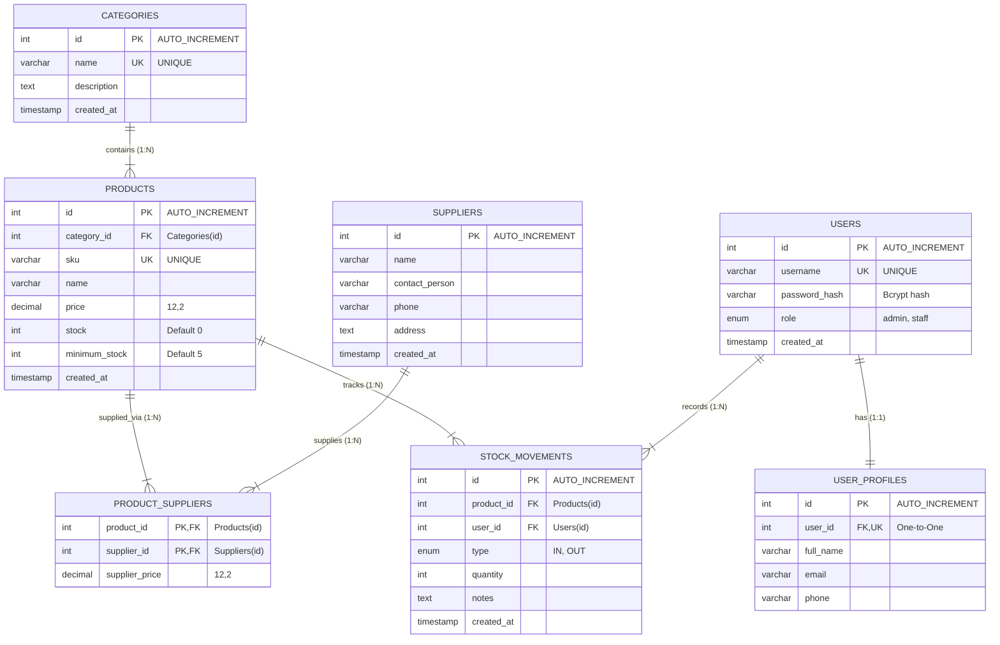
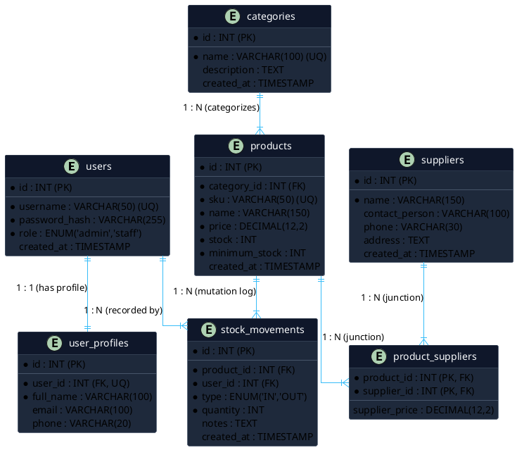

# Entity Relationship Diagram (ERD) - RetroCam Inventory Management System

Dokumen ini menyediakan diagram ERD dan kode XML/PlantUML/Mermaid untuk diimpor ke **draw.io** / Diagrams.net.

---

## 1. Visualisasi ERD (Mermaid)



---

## 2. Cara Impor ke Draw.io (Metode Tercepat: PlantUML)

1. Buka [draw.io](https://app.diagrams.net/).
2. Buat diagram baru atau buka kanvas kosong.
3. Di menu bar atas, pilih: **Arrange &rarr; Insert &rarr; Advanced &rarr; PlantUML...**
4. Salin kode berikut dan paste ke dalam kotak, lalu klik **Insert**:



---

## 3. Metode Impor via SQL DDL (Draw.io Native)

Draw.io juga mendukung fitur membuat ERD otomatis langsung dari SQL DDL:

1. Di menu bar draw.io, klik: **Arrange &rarr; Insert &rarr; Advanced &rarr; SQL...**
2. Salin query berikut dan klik **Insert**:

```sql
CREATE TABLE users (
    id INT PRIMARY KEY,
    username VARCHAR(50) UNIQUE,
    password_hash VARCHAR(255),
    role VARCHAR(20),
    created_at TIMESTAMP
);

CREATE TABLE user_profiles (
    id INT PRIMARY KEY,
    user_id INT UNIQUE,
    full_name VARCHAR(100),
    email VARCHAR(100),
    phone VARCHAR(20),
    FOREIGN KEY (user_id) REFERENCES users(id)
);

CREATE TABLE categories (
    id INT PRIMARY KEY,
    name VARCHAR(100) UNIQUE,
    description TEXT,
    created_at TIMESTAMP
);

CREATE TABLE products (
    id INT PRIMARY KEY,
    category_id INT,
    sku VARCHAR(50) UNIQUE,
    name VARCHAR(150),
    price DECIMAL(12,2),
    stock INT,
    minimum_stock INT,
    created_at TIMESTAMP,
    FOREIGN KEY (category_id) REFERENCES categories(id)
);

CREATE TABLE suppliers (
    id INT PRIMARY KEY,
    name VARCHAR(150),
    contact_person VARCHAR(100),
    phone VARCHAR(30),
    address TEXT,
    created_at TIMESTAMP
);

CREATE TABLE product_suppliers (
    product_id INT,
    supplier_id INT,
    supplier_price DECIMAL(12,2),
    PRIMARY KEY (product_id, supplier_id),
    FOREIGN KEY (product_id) REFERENCES products(id),
    FOREIGN KEY (supplier_id) REFERENCES suppliers(id)
);

CREATE TABLE stock_movements (
    id INT PRIMARY KEY,
    product_id INT,
    user_id INT,
    type VARCHAR(10),
    quantity INT,
    notes TEXT,
    created_at TIMESTAMP,
    FOREIGN KEY (product_id) REFERENCES products(id),
    FOREIGN KEY (user_id) REFERENCES users(id)
);
```
